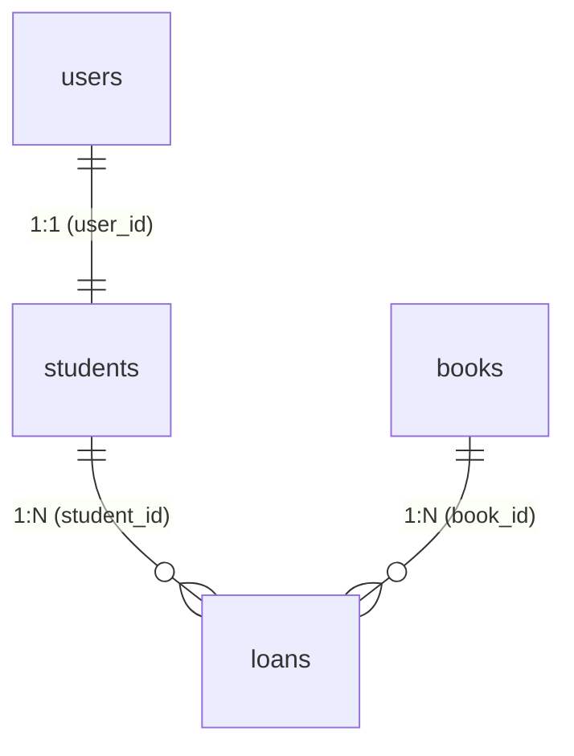

# Veritabanı Normalizasyonu ve İlişkiler Raporu

Kütüphane Yönetim Sistemi REST API projesinde kullanılan PostgreSQL veritabanı şeması, ilişkisel veritabanı tasarım ilkelerine ve **Normalizasyon (Normalization)** kurallarına tamamen uygundur. Tasarımımız **3. Normal Form (3NF)** seviyesindedir.

Aşağıda tablolarımızın normalizasyon durumları, uygulanan kurallar ve tablolar arası ilişkiler detaylı olarak açıklanmıştır.

---

## 1. Tablo Şemaları

Veritabanımızda 4 adet tablo bulunmaktadır:
1.  **`users` (Kullanıcılar):** `id` (PK), `username` (Unique), `password`, `role`
2.  **`students` (Öğrenciler):** `id` (PK), `student_number` (Unique), `name`, `email` (Unique), `user_id` (FK -> `users.id`)
3.  **`books` (Kitaplar):** `id` (PK), `title`, `author`, `isbn` (Unique), `available`
4.  **`loans` (Ödünç Alma İşlemleri):** `id` (PK), `student_id` (FK -> `students.id`), `book_id` (FK -> `books.id`), `borrow_date`, `due_date`, `return_date`

---

## 2. Normalizasyon Kurallarının Analizi

### Birinci Normal Form (1NF)
*   **Kural:** Tablodaki her sütun atomik (bölünemez/tekil) değerler içermeli ve tekrarlayan gruplar (diziler veya virgülle ayrılmış listeler) bulunmamalıdır. Her satır benzersiz olmalıdır (Primary Key bulunmalıdır).
*   **Analiz:**
    *   Öğrenci tablosunda ad, numara, e-posta gibi bilgiler tekil hücrelerde tutulmaktadır. Bir öğrencinin aldığı kitaplar öğrenci tablosunda virgülle ayrılmış bir liste olarak tutulmaz (bu 1NF'yi bozardı).
    *   Tüm tablolarımızda benzersizliği sağlayan tekil birincil anahtarlar (`id`) mevcuttur.
    *   **Sonuç:** Sistem **1NF** kuralına uygundur.

### İkinci Normal Form (2NF)
*   **Kural:** 1NF sağlanmalı ve anahtar olmayan hiçbir öznitelik (kolon), birincil anahtarın bir kısmına bağımlı olmamalıdır (kısmi bağımlılık olmamalıdır). Bu kural özellikle kompozit (birden fazla kolondan oluşan) birincil anahtarlı tablolarda geçerlidir.
*   **Analiz:**
    *   Tüm tablolarımızda tek bir kolon birincil anahtar (`id`) olarak tanımlanmıştır. Kompozit anahtar kullanılmadığı için kısmi bağımlılık (partial dependency) ihtimali yoktur.
    *   Örneğin, `loans` tablosunda `borrow_date` veya `return_date` gibi kolonlar kompozit bir anahtarın parçasına değil, doğrudan tekil `id` (ödünç alma işlemi ID'si) birincil anahtarına tam bağımlıdır.
    *   **Sonuç:** Sistem **2NF** kuralına uygundur.

### Üçüncü Normal Form (3NF)
*   **Kural:** 2NF sağlanmalı ve anahtar olmayan hiçbir öznitelik, anahtar olmayan başka bir özniteliğe bağımlı olmamalıdır (geçişli bağımlılık / transitive dependency olmamalıdır). Yani tüm kolonlar sadece ve doğrudan birincil anahtara bağlı olmalıdır.
*   **Analiz:**
    *   `students` tablosunda; `name`, `email` ve `student_number` doğrudan öğrenci `id`'sine bağlıdır. Kendi aralarında geçişli bir bağımlılık yoktur.
    *   `books` tablosunda; `title`, `author`, `isbn` ve `available` durumları doğrudan kitap `id`'sine bağlıdır.
    *   `loans` tablosunda; `borrow_date`, `due_date` ve `return_date` doğrudan ödünç alma `id`'sine bağımlıdır.
    *   Eğer `loans` tablosunda öğrencinin e-postası veya kitabın yazarının adı gibi bilgiler de tutulsaydı, bu bilgiler sırasıyla `student_id` ve `book_id` üzerinden dolaylı (geçişli) bağımlılık yaratacak ve 3NF'yi bozacaktı. Tasarımımızda bu bilgiler sadece yabancı anahtar (Foreign Key) referanslarıyla tutulduğu için veri tekrarı ve geçişli bağımlılık engellenmiştir.
    *   **Sonuç:** Sistem **3NF** kuralına uygundur.

---

## 3. Tablolar Arası İlişkiler (Relationships)

Tablolarımız arasındaki ilişkiler ve bunların normalizasyondaki rolleri aşağıda açıklanmıştır:

### A. Öğrenci (`students`) - Kullanıcı (`users`) İlişkisi
*   **İlişki Tipi:** **Birebir (1:1 - One-to-One)**
*   **Açıklama:** Her öğrencinin sistemde kimlik doğrulaması yapabilmesi için tam olarak bir kullanıcı hesabı vardır. `students` tablosundaki `user_id` yabancı anahtarı (Foreign Key), `users` tablosunun `id` birincil anahtarını referans alır.
*   **Normalizasyon Etkisi:** Kullanıcı kimlik doğrulama verileri (şifre, rol vb.) ile öğrencinin akademik verileri (isim, öğrenci numarası vb.) ayrı tablolarda tutularak mantıksal katmanlama yapılmış ve veri bütünlüğü korunmuştur.

### B. Öğrenci (`students`) - Kitap (`books`) İlişkisi
*   **İlişki Tipi:** **Çoktan Çoğa (M:N - Many-to-Many)**
*   **Açıklama:** Bir öğrenci zaman içinde birden fazla kitap ödünç alabilir. Bir kitap da farklı zamanlarda farklı öğrenciler tarafından ödünç alınabilir.
*   **Normalizasyon Etkisi:** İlişkisel veritabanlarında çoktan çoğa ilişkiler doğrudan kurulamaz. Normalizasyon gereği bu ilişkiyi çözmek ve ek verileri (ödünç tarihi, iade tarihi vb.) saklamak için **`loans`** adında bir **Ara Tablo (Junction Table / Association Table)** kullanılmıştır.

### C. Ödünç İşlemleri (`loans`) - Öğrenci & Kitap İlişkileri
*   **İlişki Tipi:** **Bire Çok (1:N - One-to-Many)**
    *   `students` (1) -> `loans` (N): Bir öğrenci birden fazla kez kitap ödünç alabilir (1:N).
    *   `books` (1) -> `loans` (N): Bir kitap tarih boyunca birden fazla kez ödünç verilebilir (1:N).
*   **Açıklama:** `loans` tablosu, `student_id` ve `book_id` yabancı anahtarlarını barındırır. Her bir ödünç alma kaydı tam olarak bir öğrenciyi ve bir kitabı işaret eder.
